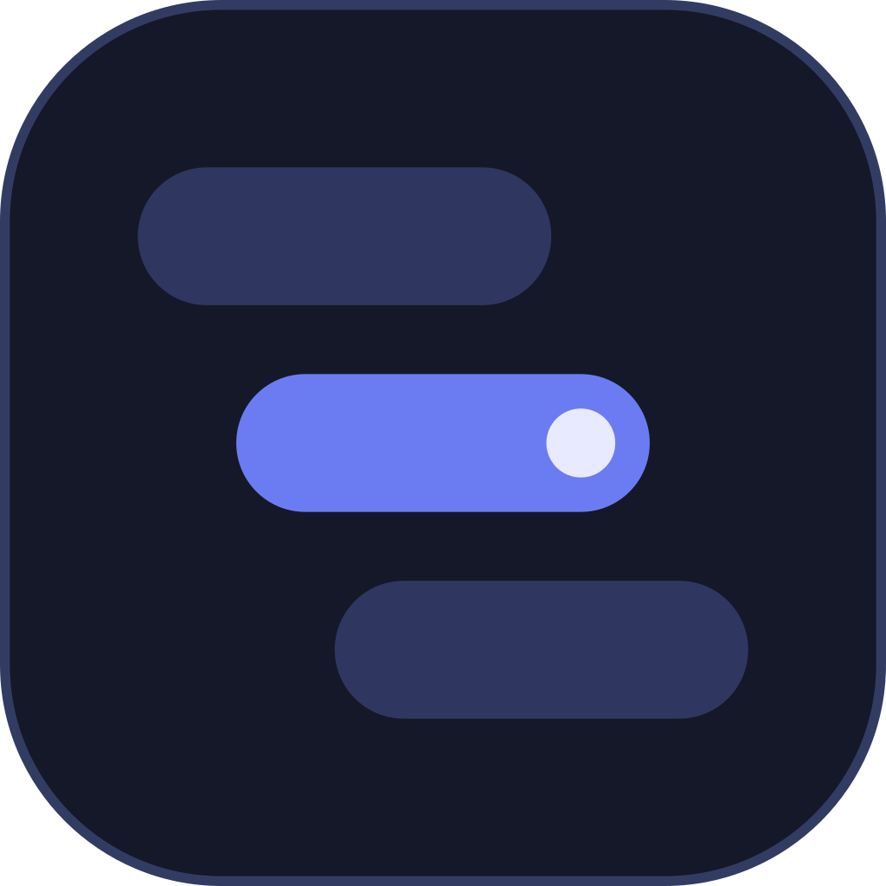

<p align="center">
  
</p>

# EzLLM

EzLLM es un cliente de escritorio para [llama.cpp](https://github.com/ggml-org/llama.cpp). Instala los runtimes oficiales, descubre y descarga modelos GGUF, detecta el hardware real y arranca `llama-server` con una línea de comandos comprensible y reproducible.

Estado: `0.1.0` · Windows x86_64 · Interfaz en español · Licencia MIT.

## Qué incluye

- **Runtime**: instala, actualiza y selecciona builds de llama.cpp desde las releases oficiales de GitHub.
- **Modelos**: busca repositorios GGUF en Hugging Face, descarga cuantizaciones y detecta compañeros `mmproj` y MTP.
- **Hardware**: detecta CPU, RAM, GPU dedicada y VRAM para ajustar el reparto y estimar memoria.
- **Servidor**: arranca y detén `llama-server`, revisa logs, slots, velocidad y contexto en vivo.
- **Argumentos**: catálogo completo extraído de `llama-server --help`, con búsqueda, categorías y edición de valores.
- **Local-first**: sin cuentas, sin telemetría y sin pesos de modelo incluidos.

## Plataforma

El objetivo actual es **Windows x86_64** (Windows 10/11 con WebView2). La app está construida con Tauri 2, React 19, TypeScript, Tailwind CSS 4 y Rust.

## Requisitos para desarrollar

- Node.js 20 o superior
- Rust estable y Cargo
- WebView2 (incluido en Windows 11; en Windows 10 puede requerir el runtime de Microsoft)
- Opcional: una build local de llama.cpp para probar la integración

## Desarrollo

```bash
npm install
npm run tauri dev
```

La configuración se guarda en `%APPDATA%\EzLLM\config.json`. Por defecto, los modelos y runtimes viven bajo `Documentos\EzLLM`.

## Compilar

```bash
npm run tauri build
```

Los instaladores se generan en `src-tauri/target/release/bundle/` (MSI y NSIS).

## Verificación

```bash
npm run build
cd src-tauri && cargo check --all-targets
```

Las pruebas de integración de Rust que descargan runtimes o modelos requieren red y un entorno local preparado; revisa `src-tauri/tests/`.

## Iconos

Los SVG fuente están en `assets/`. Para regenerar el conjunto:

```bash
npm run tauri icon assets/icon.svg
node build-icons.mjs
```

`build-icons.mjs` crea el `.ico` con capas de 16, 20, 24, 32, 48, 64 y 256 px, usando una variante de trazo más grueso para los tamaños pequeños. Windows puede cachear iconos; si no se actualiza el de la barra de tareas, reinicia el Explorador o limpia la caché de iconos.

## Licencia

MIT. Consulta [LICENSE](LICENSE).
